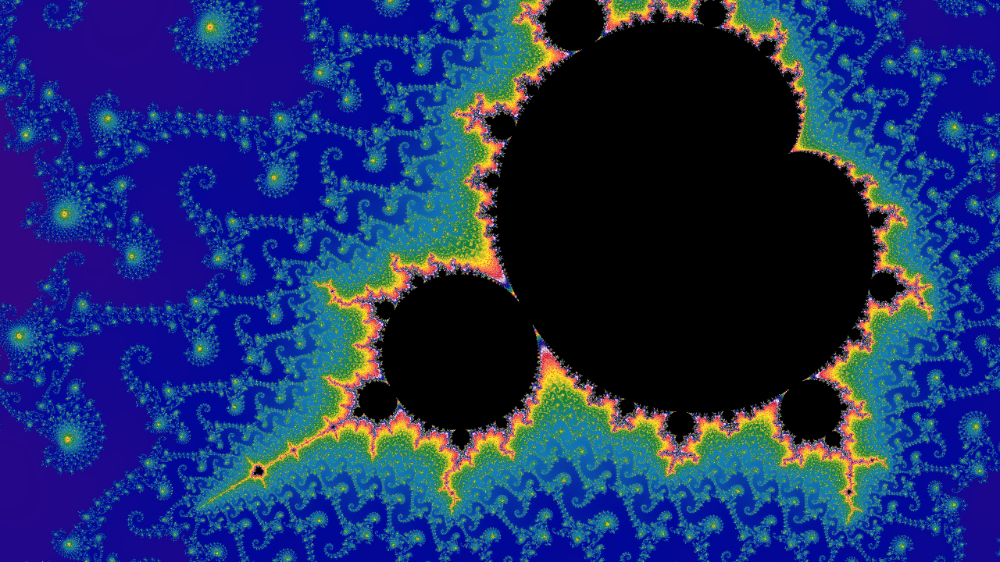

# Project 1 Report: CUDA Mandelbrot Renderer
余晨昱 22621221

## 1. CUDA kernel 与像素映射

每个 thread 负责一个像素。block 的大小我固定取 16×16，grid 的大小则跟着图像尺寸走：宽和高分别除以 16 再向上取整，代码里写成 `(width + 15) / 16` 这样的整数形式。向上取整之后，只要图像尺寸不是 16 的倍数，边缘的 block 就会多出一些落在图像外面的 thread。所以 kernel 一进来先用 `blockIdx * blockDim + threadIdx` 算出自己对应的全局像素坐标 `(x, y)`，如果 `x >= width` 或者 `y >= height` 就直接返回。

```cpp
int const x = static_cast<int>(blockIdx.x * blockDim.x + threadIdx.x);
int const y = static_cast<int>(blockIdx.y * blockDim.y + threadIdx.y);
if (x >= parameters.width || y >= parameters.height) {
    return;
}
```

有了像素坐标，下一步是把它换算成复平面上的点 $c$。先取像素中心 `(x + 0.5, y + 0.5)`，减去图像中心 `(width / 2, height / 2)`，得到一个以图像中心为原点的偏移，此时单位还是像素；再乘上 `pixelScale` 换成复平面上的偏移，最后加上相机中心 `directCenter`：

```cpp
c.re = directCenter.re + (x + 0.5 - width  / 2) * pixelScale
c.im = directCenter.im + (y + 0.5 - height / 2) * pixelScale
```

`pixelScale` 表示一个像素在复平面上对应多长，由 host 端按 `4 / (zoom * height)` 算好后传进来，所以 zoom 为 1 时画面纵向刚好覆盖长度 4。

横纵两个方向用同一个 `pixelScale` -- 这是为了画面不随宽高比被拉伸。

迭代公式是 $z_0 = 0,\ z_{n+1} = z_n^2 + c$。每一轮先检查 $|z|^2$ 有没有超过 256（代码里的 `kEscapeRadiusSquared`，相当于模长超过 16），比较平方可以省掉一次开方。一旦超过，就认为这个点逃逸了，记下此时的迭代次数 $i$，再用 $i + 1 - \log_2(\ln|z|)$ 算出 smooth iteration。
> 直接拿整数 $i$ 上色会出现一圈一圈的色带，加上这个小数修正之后颜色才能连续过渡。

如果一直迭代到 `maxIter` 都没有逃逸，就把它当作集合内部的点。`maxIter` 不是固定值，它随 zoom 增长（我的代码里的设定为 `256 + 128 * log2(zoom)`，上限 20000），因为放得越深，边界附近的点要迭代更多次才能分辨出来。

着色只用到上面的结果：内部点直接涂黑，然后逃逸的点把 smooth iteration 交给 starter 提供的 `Palette::sample()` 查出 RGB。最后每个像素往 `output[y * width + x]` 写一个 `float4`，alpha 固定为 1.0。

## 2. 1x1 / 2x2 采样

两种采样模式共用同一个 kernel，靠 `RenderParameters` 里的 `antialias` 这个 bool 来区分。

1x1 就是每个像素只在中心采一次样，子像素偏移为 0。

2x2 则是在一个像素内部采四次样。把像素想成一个 1×1 的小方格，四个采样点分别落在它四个象限的中心，也就是相对像素中心偏移 `(±0.25, ±0.25)`。偏移是在映射到复平面之前加到像素坐标上的，所以后面的映射和迭代完全不用改：

```cpp
double const fragmentX = static_cast<double>(static_cast<float>(x) + 0.5f + subPixelX);
double const fragmentY = static_cast<double>(static_cast<float>(y) + 0.5f + subPixelY);
```

四个采样点各自跑完迭代、各自查 palette 得到颜色，最后把四个 RGB 加起来乘 0.25：

```cpp
for (int sampleY = 0; sampleY < 2; ++sampleY) {
    for (int sampleX = 0; sampleX < 2; ++sampleX) {
        float const offsetX = sampleX == 0 ? -0.25f : 0.25f;
        float const offsetY = sampleY == 0 ? -0.25f : 0.25f;
        float3 const sample = shade(sampleMandelbrot(x, y, offsetX, offsetY, ...), parameters);
        color.x += sample.x;
        color.y += sample.y;
        color.z += sample.z;
    }
}
color.x *= 0.25f;
color.y *= 0.25f;
color.z *= 0.25f;
```

四次采样都在同一个 thread 里顺序完成，block / grid 的划分和 1x1 时一样，但是代价是每个像素的迭代量变成原来的四倍。

---

`antialias` 的来源：命令行用 `--aa` 指定，不指定时 online 模式默认 1x1，offline 模式默认 2x2；online 模式下还可以按 A 键随时切换。两条路径最后都是把这个值填进 `RenderParameters::antialias` 再传给 kernel。

## 3. Online 模式的 SSBO interop 同步

online 模式下，像素不经过 CPU -- CUDA 直接把结果写进一块 OpenGL 的 SSBO，OpenGL 再从同一块 buffer 里读出来画到屏幕上。同一块内存两边都要用，但是任何时刻都只能有一方访问它。

```cpp
m_colorBufferResource->map();                                    // 1. 所有权交给 CUDA
float4* output = m_colorBufferResource->getMappedPointer<float4>(&mappedPixelCount);
frameInfo = m_mandelbrotCompute->render(output, ...);            // 2. 启动 kernel 写入 output
m_colorBufferResource->unmap();                                  // 3. 所有权还给 OpenGL

m_colorBuffer->bindAsShaderStorage(0);                           // 4. OpenGL 读取并绘制
gfx::RHI::draw(gfx::RHI::Primitive::Triangles, 0, 3);
```

`map` 和 `unmap` 之间 buffer 归 CUDA，这段时间里 OpenGL 不碰它。

`unmap` 之后归 OpenGL，`output` 这个指针也就失效了，所以它每一帧都重新取。

kernel 的启动是异步的（CPU 提交作业到 stream 上，然后 CPU 就自己干自己的了，GPU 按照作业顺序异步执行），`render` 返回时它不一定跑完了，我也没有额外调用 `cudaDeviceSynchronize`，所以真正起同步作用的是 `unmap`，`cudaGraphicsUnmapResources` 保证在它之前提交的 CUDA 任务全部完成之后，后面的 OpenGL 命令才会开始执行（kernel 和 unmap 用的都是 default stream），这样绘制就不会出错了。

窗口大小改变的时候 buffer 需要重建 -- 先用 `cudaDeviceSynchronize` 和 `glFinish` 等两边的工作做完，注销 CUDA resource，删掉旧的 OpenGL buffer，然后再按新尺寸创建、重新注册。

## 4. 高精度相机

相机的 center 和 zoom 在 CPU 上用 `HighPrecisionFloat` 保存（Boost.Multiprecision 的 `cpp_dec_float<100>`，100 位十进制有效数字）。默认的终点 zoom 是 `1.6e22`，`double` 只有大约 16 位有效数字，如果一开始就把 center 转成 `double`，放大到后面相机就对不准目标点了。

每一帧先由 starter 提供的 `cameraAtTime` 在高精度下算出当前的 center 和 zoom，转换成 `double` 只发生在填 `RenderParameters` 的最后一步：

```cpp
double const pixelScale =
    (HighPrecisionFloat(4) / (camera.zoom * HighPrecisionFloat(framebufferHeight))).convert_to<double>();
RenderParameters parameters{
    ...
    .pixelScale = pixelScale,
    .directCenter = toComplex(camera.center),
};
```

这样相机的轨迹是准确的，不过 kernel 内部仍然是 `double` 运算，深度放大时的精度仍然存在问题。

## 5. Offline 截图

下面这张图是 offline 模式在 zoom 为 `1e6` 时渲染的，分辨率 1280×720，2x2 采样，`maxIter` 为 2807。命令如下：

```sh
./project1 --offline --width 1280 --height 720 --aa 1 \
    --re -0.743643887 --im 0.131825904 --zoom 1e6 \
    --output zoom1e6_iter2807_re-0.743643887_im0.131825904_aa1_1280x720.png
```



## 6. 性能与已知限制

### 性能

测试环境是 RTX 5060 Laptop GPU，offline 模式，分辨率 1280×720。下表是 offline 模式打印的渲染时间，用 CUDA event 计时，只包含 kernel 的执行，不包含把结果拷回 CPU 和写 PNG 的时间。zoom 为 1 时 center 取 `(-0.5, 0)`，其他的都是第 5 节截图用的 center。

| zoom | maxIter | 1x1 | 2x2 |
| --- | --- | --- | --- |
| 1 | 256 | 1.4 ms | 5.6 ms |
| 1e3 | 1531 | 14 ms | 56 ms |
| 1e6 | 2807 | 80 ms | 320 ms |
| 1e9 | 4082 | 79 ms | 316 ms |
| 1e12 | 5358 | 67 ms | 267 ms |

2x2 的耗时基本是 1x1 的四倍。另外耗时并不是单纯跟着 `maxIter` 走的：`1e6`、`1e9`、`1e12` 三个位置的 `maxIter` 差了近一倍，耗时却差不多。我统计了一下，这三个位置平均每个像素实际迭代的次数都在 1000 次左右，所以真正决定耗时的是实际迭代了多少次，而不是上限设了多少。

为了弄清楚时间具体花在哪里，我在同一台机器上用 Nsight Systems 和 Nsight Compute 对默认动画做了 profiling（1280×720，2x2，把动画逐帧渲染出来，每秒取 1 帧，共 151 帧）。结论大致是三条：

- 96.1% 的时间花在 kernel 的迭代上。把结果拷回 CPU 只占 0.4%，CPU 端的格式转换和编码加起来约 3.5%。
- kernel 内部的瓶颈是 `double` 运算。FP64 流水线的占用率是 84–85%，调度器有大约 94% 的周期找不到可以发射的 warp，大部分时间都在排队等 FP64 运算。
- warp 内线程互相等待不是主要问题。每个 warp 的 32 个 thread 里平均有 28–32 个是活跃的。

### 已知限制

**深度放大时精度不够。** 我没有实现 perturbation，kernel 里的 $c$ 是直接用 `double` 算的。`double` 在 1 到 2 之间能分辨的最小间隔大约是 `2.2e-16`，而 720p 下 zoom 到 `1e13` 时一个像素对应的长度已经只有 `5.6e-16`，再往后相邻的像素就会算出同一个 $c$。用默认的目标点实际渲染，zoom 为 `1e12` 时画面正常，`1e13` 开始变糊，到 `1e15` 已经完全变成一条条竖直的色带。默认动画的终点是 `1.6e22`，按对数插值算，大约从第 78 秒（共 150 秒）开始画面就不对了，而这一段占了整段动画渲染时间的 55%。

**集合内部的点没有提前退出。** 内部点每个都要跑满 `maxIter` 才能确定不逃逸，所以画面里黑色区域越大越慢。以第 5 节那张截图为例，内部点只占 26% 的像素，却占了约 72% 的迭代量。

### 后续优化方向

既然时间几乎都花在 kernel 里，kernel 又卡在 FP64 上，接下来我想先从这里下手。下面这些都还没做，按打算做的先后顺序排：

- **FMA。** Nsight Compute 提示大约 87% 的 FP64 指令没有融合成 FMA，也就是 `z * z + c` 里的乘和加大多是分开算的。改内层循环的几行就行，工具估计最多能快 44% 左右。
- **周期检测。** 像第 5 节那张截图，内部点只占四分之一的像素，却占了七成的迭代量。迭代时隔一段记一个 $z$，后面如果又回到这个值，说明轨道在绕圈，肯定逃不出去，可以直接停。不过每次迭代要多比较一次，对没有内部点的画面是亏的，得挑几种画面分别测。
- **`maxIter` 的系数。** 现在是 `256 + 128 * log2(zoom)`，可能设得偏大了。
- **只对需要的像素做 2x2 采样。** 平滑的地方采一次就够，会影响画面，需要看着实际渲染效果调。
- **perturbation。** bonus。它本来是解决深度放大精度问题的，但对速度可能也有帮助：每个像素只迭代相对参考点的一个很小的偏移量，有机会用 `float` 来算，这样就绕开了 FP64。
