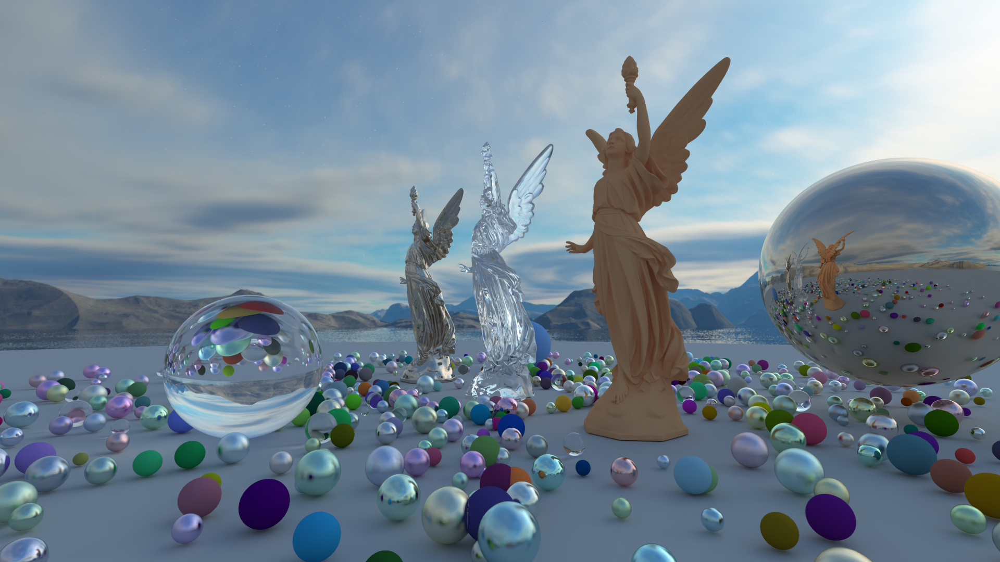
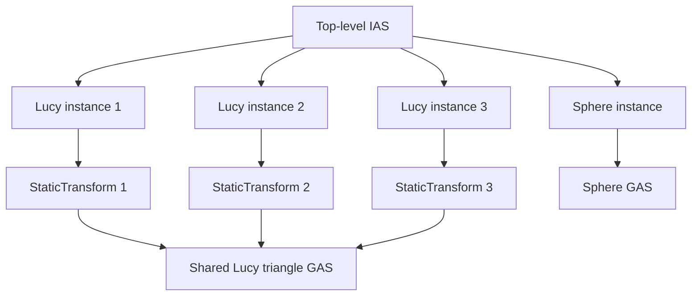

# Project 2: OptiX ray tracer

`project2` uses OptiX to render three instances of Lucy, a ground sphere, a
randomized sphere field, and a six-face skybox. It supports an interactive
OpenGL viewer and offline PNG rendering. See the repository-wide
[README](../../README.md) for setup and [ASSIGNMENT.md](ASSIGNMENT.md) for
implementation requirements.



## Scene structure

The top-level instance acceleration structure (IAS) contains four instances.
Three Lucy instances each have a separate static transform, but all reference
the same triangle geometry acceleration structure (GAS). The fourth instance
references a sphere GAS containing the ground, the randomized sphere field, and
three larger spheres. That GAS uses OptiX's built-in sphere primitive.



The skybox is sampled by the miss program, outside the IAS. The raygen program
traces up to 16 bounces with Lambertian, metal, and dielectric materials. The
sphere layout uses a fixed random seed.

## Dependencies

`project2` requires a compatible NVIDIA GPU and driver, the CUDA Toolkit, and
the following vcpkg manifest dependencies:

- OptiX 9.1 headers for ray tracing
- tinyobjloader for loading Lucy
- GLM for camera math
- STB for decoding the skybox and writing PNG images
- GLAD and GLFW for online OpenGL rendering

Online mode also requires an OpenGL 4.5-capable environment. The offline-only
build does not compile or link the online OpenGL viewer, so it does not require
GLAD, GLFW, or a window-system development stack. It still requires CUDA,
OptiX, tinyobjloader, GLM, and STB.

On Ubuntu or Debian, online OpenGL rendering additionally requires the system
development packages used by GLFW's X11 backend:

```sh
sudo apt-get update
sudo apt-get install -y \
    pkg-config \
    libxinerama-dev \
    libxcursor-dev \
    xorg-dev \
    libglu1-mesa-dev
```

The CMake/vcpkg manifest supplies the C++ libraries; these packages provide
the X11/OpenGL development files needed while GLFW is built.

## Build

Configure and build from the repository root with a vcpkg preset. On Windows,
run these commands from Developer PowerShell for VS in Windows Terminal:

```powershell
cmake --preset windows-vs-release-vcpkg
cmake --build --preset windows-vs-release-vcpkg --target project2
```

Use `windows-vs-debug-vcpkg` for a Debug build. On Linux, use the corresponding
Linux preset:

```sh
cmake --preset linux-gcc-release-vcpkg
cmake --build --preset linux-gcc-release-vcpkg --target project2
```

The build generates `assets/optix/project2.optixir` from
`src/optix_programs.cu`. CMake checks the timestamps of
`src/optix_programs.cu` and `include/launch_params.h` and rebuilds the OptiX IR
when either file changes. The build copies the IR, `assets/models/lucy.obj`,
and the six skybox images into the executable's `assets/` directory.

## Online mode

Run `project2` without `--offline` to open the viewer. The default window size
is 1280x720. On Windows, for example:

```powershell
.\out\build\windows-vs-release-vcpkg\projects\project2\project2.exe
```

Use WASD to move horizontally, Q/E to move vertically, and the mouse wheel to
move toward or away from the scene. The camera stays aimed at the scene center.
Moving the camera or resizing the framebuffer resets the running average.
Press Space to toggle denoising and Escape to close the window. The window
title shows the denoiser state; toggling it preserves the raw sample average.
The viewer starts with denoising enabled. It takes four samples on the first
frame after an accumulation reset when denoising is enabled, then one sample
per frame.

## Offline mode

`--offline` renders one image without opening a window, prints the render time,
and writes an RGBA PNG. The defaults are 1920x1080, 64 samples per pixel, and
denoising enabled. For example:

```sh
./project2 --offline \
    --width 640 --height 360 --samples 64 --denoiser on --output render.png
```

| Option | Meaning |
| --- | --- |
| `--offline` | Render one PNG; online mode is the default. |
| `--width <pixels>` | Positive image or window width. |
| `--height <pixels>` | Positive image or window height. |
| `--samples <count>` | Positive offline sample count; default: `64`. |
| `--denoiser <state>` | Offline denoising: `on`, `off`, `1`, or `0`; default: `on`. |
| `--output <path>` | Offline PNG path. |
| `--help` / `-h` | Print command-line help. |

Without `--output`, the filename is
`output_<width>x<height>_<samples>s_<denoised|raw>.png`. Relative output paths
are resolved from the current working directory. `--samples` and `--denoiser`
are accepted in online mode, but do not change its startup behavior; use
Space to control viewer denoising. `--output` requires `--offline`.

## Building without OpenGL

For machines or course submissions that do not have OpenGL development
libraries, configure `project2` with `PROJECT2_OFFLINE_ONLY=ON`.

### Top-level build

From the repository root, pass the option while configuring the top-level
project with a vcpkg preset.

On Linux:

```sh
cmake --preset linux-gcc-release-vcpkg -DPROJECT2_OFFLINE_ONLY=ON
cmake --build --preset linux-gcc-release-vcpkg --target project2
```

On Windows, run the following commands from Developer PowerShell for VS in
Windows Terminal:

```powershell
cmake --preset windows-vs-release-vcpkg -DPROJECT2_OFFLINE_ONLY=ON
cmake --build --preset windows-vs-release-vcpkg --target project2
```

### Standalone build

To configure only `project2`, run the commands below from the repository root.
This uses the local `vcpkg/` checkout and the repository-root `vcpkg.json`
described in the repository README.

On Linux:

```sh
cmake -S projects/project2 -B out/build/project2-offline \
    -DPROJECT2_OFFLINE_ONLY=ON \
    -DCMAKE_TOOLCHAIN_FILE="$PWD/vcpkg/scripts/buildsystems/vcpkg.cmake" \
    -DVCPKG_MANIFEST_DIR="$PWD" \
    -DVCPKG_TARGET_TRIPLET=x64-linux \
    -DCMAKE_BUILD_TYPE=Release
cmake --build out/build/project2-offline --target project2 --parallel
```

On Windows, use `x64-windows` and the Release configuration. Run the following
commands from Developer PowerShell for VS in Windows Terminal:

```powershell
cmake -S projects/project2 -B out/build/project2-offline `
    -DPROJECT2_OFFLINE_ONLY=ON `
    "-DCMAKE_TOOLCHAIN_FILE=$PWD/vcpkg/scripts/buildsystems/vcpkg.cmake" `
    "-DVCPKG_MANIFEST_DIR=$PWD" `
    -DVCPKG_TARGET_TRIPLET=x64-windows
cmake --build out/build/project2-offline --target project2 --config Release --parallel
```

This option removes the online viewer and its OpenGL/GLAD/GLFW dependencies
from the target. GLM remains required for the offline camera. The resulting
executable accepts offline rendering only, so it must be invoked with
`--offline`.

## Submission

Build the source package from a configured repository build:

```powershell
cmake --build --preset windows-vs-release-vcpkg --target submit_project2
```

On Linux:

```sh
cmake --build --preset linux-gcc-release-vcpkg --target submit_project2
```

The archive is written to
`out/build/<preset>/projects/project2/submission/project2.zip`. It includes
Project 2 source and the shared `base/` files used by the project, but excludes
`assets/`.
