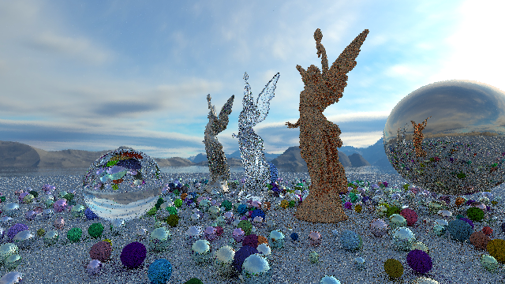

# Project 2：基于 OptiX 的路径追踪渲染器

## 1. 概述

本次实验在课程提供的框架上，用 OptiX 实现了一个渐进式路径追踪渲染器。场景由框架给定：三个材质各异的 Lucy 模型、地面、三个主体球体和随机分布的小球阵列，背景是天空 cubemap。我负责的部分包括两方面：设备端的 OptiX 程序（天空采样、三种材质的散射、triangle 与 sphere 的 closest-hit），以及 host 端 `OptixRenderer` 的资源管理、逐 sample launch 和结果累积。渲染结果既可以在 OpenGL 窗口中实时查看，也可以离线渲染为 PNG。此外，我还完成了 bonus 部分，即基于 OptiX denoiser 的单帧降噪和 temporal 降噪。

下文沿着光线在渲染器中的流程展开：先介绍场景如何组织成 OptiX 可遍历的结构，再介绍光线命中后的着色与路径追踪，然后是多帧结果的累积与输出，最后是在累积结果之上的降噪。

## 2. 场景组织

场景几何分别放在两个 geometry acceleration structure（GAS）中。Lucy 的 OBJ 网格展开为三角形顶点和法线数组，构建成一个 triangle GAS；三个 static-transform 节点以不同的变换引用这同一个 GAS，因此三个 Lucy 实例只需存储一份几何数据。地面和所有球体都使用 OptiX 内置的 sphere primitive，放在第二个 GAS 中。顶层 IAS 由三个 Lucy 实例和一个 sphere 实例组成。

材质通过 SBT 传递给着色程序。SBT 包含一个 raygen record、一个 miss record 和四个 hitgroup record。其中 record 0–2 对应三个 Lucy 实例，它们共享同一个法线指针，但各自携带独立的材质；record 3 对应 sphere 实例，存放每个球体的材质数组。

## 3. 着色与路径追踪

光线命中物体后，closest-hit 程序先计算表面法线。对三角形，用重心坐标插值三个顶点的物体空间法线，再变换到世界空间；对球体，从 OptiX 取得球心和半径，由命中点相对球心的方向得到法线。

有了法线，再根据材质类型决定光线的出射方向：

- **Lambertian**：余弦加权的半球采样。
- **Metal**：沿镜面反射方向出射，并叠加一个按 fuzz 缩放的随机单位向量扰动；扰动后的方向若落到表面以下，路径即终止。
- **Dielectric**：根据光线是从外部射入还是从内部射出选取 IOR 比值。发生全内反射时只做反射，否则以 Schlick 近似的 Fresnel 项作为反射概率，在反射和折射之间随机选择。

路径的多次弹射不通过递归调用 `optixTrace` 实现，而是在 raygen 程序中循环完成，每条路径最多 16 次 bounce，因此 pipeline 的 `maxTraceDepth` 只需设为 1。循环中分别维护 radiance 和 throughput：每次命中表面，将材质 albedo 乘到 throughput 上；光线逃逸出场景时，在 raygen 中以光线方向采样天空 cubemap，把采样值从 sRGB 转换到线性空间，乘以 throughput 和天空强度后累加到 radiance。

为了让多帧结果能够收敛，每个像素的主光线都在像素范围内随机抖动；随机数序列按像素独立生成，并随 frame index 变化，保证每一帧采到不同的路径。

## 4. 渐进累积与输出

每次 launch 每个像素只追踪一条路径，单帧噪声很大，因此需要把多帧结果平均起来。`OptixRenderer` 为每个像素分配浮点累积缓冲区，每个 sample 对应一次 OptiX launch：第 0 个 sample 直接写入，之后按增量平均更新：

```text
average = previous + (current - previous) / (sample + 1)
```

frame index 每次 launch 都会递增，用于产生新的随机数；是否从头开始累积，则由调用方传入的起始 sample index 决定。交互模式下，相机移动或窗口尺寸变化都会将 sample 计数清零，尺寸变化时还会重新分配累积缓冲区。

输出分为两种模式。交互模式下，OptiX 直接写入一个注册到 CUDA 的 OpenGL buffer：渲染期间 map，渲染结束后 unmap，再交给 OpenGL 显示。离线模式不初始化 OpenGL，渲染完成后保存为 RGBA PNG。两种模式中，累积结果始终以线性浮点值保存，只在最终显示或写入文件时才转换到 sRGB。

## 5. 降噪（Bonus）

渐进累积虽然最终会收敛，但噪声只按 1/√N 下降，收敛很慢；交互模式下更明显，相机一动累积就清零，画面始终只有寥寥几个 sample，满屏都是噪点。为此，我在累积结果之上接入了 OptiX 的 AI denoiser，使用框架预设的 `OPTIX_DENOISER_MODEL_KIND_TEMPORAL_AOV` 模型，并启用 albedo 和 normal 两个 guide。

### 5.1 单帧降噪与 guide

denoiser 以 raw 累积图为输入，结果写入用于显示的 `pixels` buffer；raw 平均值始终保留在累积缓冲区中，不会被降噪结果覆盖，因此关闭降噪后显示的仍是正确的 raw 结果。

guide 由 raygen 在追踪路径时顺带生成，并按与 radiance 相同的增量公式在各 sample 间平均，从而与累积图保持对齐。albedo 记录表面颜色，normal 记录世界空间法线（OptiX 的 AOV 模型要求使用世界空间法线）。

最初的实现只记录主光线第一次命中的表面，结果玻璃 Lucy 和金属球降噪后都变得模糊。原因在于这些物体本身的颜色和法线几乎是均匀的，guide 中看不出它们反射或折射出的内容，denoiser 便把这些内容当作噪声抹平了。改进后，遇到 Metal 或 Dielectric 时不立即记录，而是沿镜面路径继续追踪，直到第一个 Lambertian 表面或天空才记录，albedo 同时乘上沿途镜面的颜色。这样处理后，玻璃中的折射轮廓和金属球中的倒影都得以保留。

由于 guide 只在降噪开启时写入，交互模式中按 Space 打开降噪时会清零累积、重新开始，避免 guide 与累积图不一致。

### 5.2 Temporal 降噪

逐帧独立降噪时，相机运动中相邻两帧的降噪结果略有差异，画面会闪烁。temporal 模式让 denoiser 参考上一帧的降噪结果，为此需要额外提供每个像素的运动信息：

- **flow**：raygen 记录主光线的命中点（打到天空时记录方向），用主光线生成公式的逆变换将其投影到上一帧的相机中，求出它在上一帧的像素位置；当前位置与该位置之差即为 flow。
- **flow trustworthiness**：检查上一帧对应像素记录的表面。只有表面 ID 相同、且两点距离小于到相机距离的 2% 时才视为可信；否则认为该区域是遮挡关系变化后新露出的部分，不使用历史信息。

每帧降噪后，renderer 保存输出图像、internal guide layer、主光线命中点和相机参数，供下一帧作为历史使用。窗口尺寸改变，或某一帧未开启降噪时，`resetTemporalHistory` 会使历史失效，下一帧重新作为序列的首帧处理。离线模式只渲染一帧，因此等同于单帧降噪。

## 6. 结果

实验环境为 Windows，GPU 为 NVIDIA GeForce RTX 5060 Laptop GPU（compute capability 12.0），使用 CUDA 13.2、OptiX 9.1 和 OpenGL 4.5，OptiX IR 编译目标为 `compute_120`。Release、Debug 以及 `PROJECT2_OFFLINE_ONLY=ON` 三种构建均能正常编译和运行；从其他工作目录按路径调用可执行文件时，资源和 OptiX IR 都能正确加载；`submit_project2` 生成的压缩包不包含 `assets/`。

### 6.1 路径追踪

离线渲染命令示例：

```powershell
project2.exe --offline --width 640 --height 360 --samples 256 --denoiser off --output offline-640x360-256s.png
```

在 320x180 分辨率下，我分别渲染了 1 sample 和 64 sample 的图像：两者场景内容一致，64 sample 的 Monte Carlo 噪声明显更少，说明累积逻辑工作正常。下图是 640x360、256 sample、未降噪的离线渲染结果，渲染耗时约 0.219 秒。


### 6.2 降噪

下表在 640x360 分辨率、相同 sample 数下对比 raw 与降噪结果：

| sample | raw | denoised |
| --- | --- | --- |
| 1 |  |  |
| 16 |  |  |

1 sample 时，raw 图布满噪点；降噪后 Lucy、地面和小球都已干净，边缘清晰，玻璃和金属中的反射与折射也基本保留。到 16 sample 时，降噪结果已接近收敛画面。离线计时（含降噪）如下：1 sample 时 raw 约 0.9 ms、降噪后约 8.9 ms；16 sample 时 raw 约 17.7 ms、降噪后约 27.3 ms。也就是说，在该分辨率下每次降噪约增加 9–10 ms。

交互模式下，开启降噪后拖动视角时的噪点基本消失，按 Space 可以在 raw 和降噪画面之间切换。启用 temporal 降噪后，持续拖动视角时画面稳定，快速平移或转身时没有明显拖影；改变窗口大小后，渲染和降噪都能正常工作。

## 7. 已知局限

- 镜面路径上的 guide 本身带有随机性（Fresnel 反射与折射是随机选择的），低 sample 时玻璃 Lucy 上会残留少量细碎亮点，随 sample 增加逐渐消失。
- 降噪是神经网络对干净画面的估计，并不增加真实采样。低 sample 时，焦散之类的细节可能被抹平，最终画面质量仍以 raw 结果的收敛为准。
- trustworthiness 只依据表面 ID 和距离阈值判断，对同一物体内部细小的自遮挡可能不够敏感。
