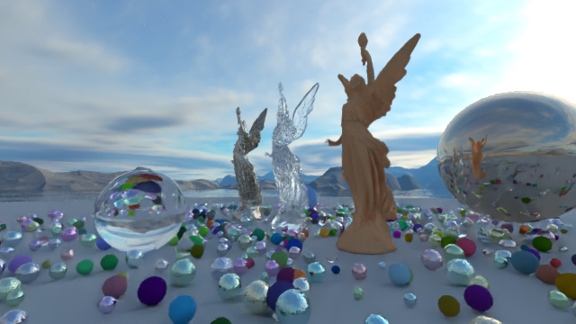
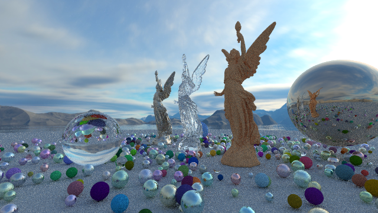

# Project 2：基于 OptiX 的路径追踪渲染器

## 1. 概述

本次实验在课程提供的框架上，用 OptiX 实现了一个渐进式路径追踪渲染器。场景由框架给定：三个不同材质的 Lucy 模型、一个地面、三个主体球体，以及随机分布的小球阵列，背景为天空 cubemap。我完成的部分包括 OptiX 设备端程序（天空采样、三种材质的散射、triangle 与 sphere 的 closest-hit）和 host 端 `OptixRenderer` 的资源管理、逐 sample launch 与结果累积。渲染结果既可以在 OpenGL 窗口中实时查看，也可以离线渲染并保存为 PNG。在此基础上，我还完成了 bonus 部分：基于 OptiX denoiser 的单帧降噪和 temporal 降噪。

下文按光线在渲染器中的流程依次说明：先是场景如何组织成 OptiX 能遍历的结构，然后是光线命中后的着色与路径追踪，接着是多帧结果如何累积并输出，最后介绍如何在累积结果之上做降噪。

## 2. 场景组织

场景几何分为两个 geometry acceleration structure（GAS）。Lucy 的 OBJ 网格展开为三角形顶点和法线数组，构建成一个 triangle GAS，再由三个 static-transform 节点以不同的变换引用它，这样三个 Lucy 实例只需存一份几何数据。地面和所有球体都用 OptiX 内置的 sphere primitive 表示，放在第二个 GAS 中。顶层 IAS 包含三个 Lucy 实例和一个 sphere 实例。

材质通过 SBT 传给着色程序。SBT 中有一个 raygen record、一个 miss record 和四个 hitgroup record：record 0–2 分别对应三个 Lucy 实例，共享同一个法线指针，但各自带有自己的材质；record 3 对应 sphere 实例，存放每个球体的材质数组。

## 3. 着色与路径追踪

光线命中物体后，closest-hit 程序首先求出表面法线。对三角形，用重心坐标插值三个顶点的物体空间法线，再变换到世界空间；对球体，从 OptiX 取得球心和半径，用世界空间的命中点减去球心得到法线。

得到法线后，根据材质类型决定光线的下一个方向：

- **Lambertian**：余弦加权的半球采样。
- **Metal**：沿镜面反射方向出射，并叠加一个按 fuzz 缩放的随机单位向量扰动；若扰动后方向落到表面以下，则终止这条路径。
- **Dielectric**：根据光线从外部射入还是从内部射出选取 IOR 比值，发生全内反射时只做反射，否则以 Schlick 近似的 Fresnel 项作为反射概率，在反射与折射之间随机选择。

路径的弹射没有采用递归调用 `optixTrace`，而是在 raygen 程序中循环完成，每条路径最多 16 次 bounce，因此 pipeline 的 `maxTraceDepth` 设为 1 即可。循环中分别维护 radiance 和 throughput：每次命中表面，把材质 albedo 乘到 throughput 上；光线逃逸出场景时，在 raygen 中直接用光线方向采样天空 cubemap，将其从 sRGB 转换为线性值，乘以 throughput 和天空强度后累加到 radiance。

为了让多帧结果能够收敛，每个像素的主光线在像素内做随机抖动，随机数序列按像素独立生成，并随 frame index 变化，保证每一帧采到不同的路径。

## 4. 渐进累积与输出

单次 launch 每像素只追踪一条路径，噪声很大，因此需要把多帧结果平均起来。`OptixRenderer` 为每个像素分配一块浮点累积缓冲区，每个 sample 对应一次 OptiX launch。第 0 个 sample 直接写入，之后按增量平均更新：

```text
average = previous + (current - previous) / (sample + 1)
```

frame index 每次 launch 都递增，用于产生新的随机数；是否从头开始累积则由调用方传入的起始 sample index 决定。在交互模式下，相机移动或窗口尺寸变化都会让 sample 计数归零，尺寸变化时还会重新分配累积缓冲区。

输出有两条路径。交互模式下，OptiX 直接写入一个注册到 CUDA 的 OpenGL buffer：渲染期间 map，渲染结束 unmap 后再交给 OpenGL 显示。离线模式不初始化 OpenGL，渲染完成后保存为 RGBA PNG。两种模式下累积结果都保持为线性浮点值，只在最终显示或写文件时才转换到 sRGB。

## 5. 降噪（Bonus）

渐进累积虽然能收敛，但噪声只按 1/√N 下降；而在交互模式下，相机一动累积就清零，画面始终停留在几个 sample 的水平，看起来像满屏雪花。为此我在累积结果之上接入了 OptiX 的 AI denoiser，采用框架预设的 `OPTIX_DENOISER_MODEL_KIND_TEMPORAL_AOV` 模型，并开启 albedo 和 normal 两个 guide。

### 5.1 单帧降噪与 guide

denoiser 的输入是 raw 累积图，输出写入显示用的 `pixels` buffer，raw 平均值始终保留在累积缓冲区中，不会被降噪结果覆盖。因此关闭降噪后，看到的仍是正确的 raw 结果。

guide 由 raygen 在追踪路径时顺带生成，并与 radiance 按同样的增量公式在各 sample 间平均，保证与累积图对齐。albedo 记录表面颜色，normal 记录世界空间法线（OptiX 的 AOV 模型要求世界空间法线）。最初我只记录主光线第一次命中的表面，结果发现玻璃 Lucy 和金属球降噪后变得模糊：它们本身的颜色和法线几乎是均匀的，guide 里看不到其中反射或折射出来的内容，denoiser 就把这些内容当作噪声抹平了。改进后的做法是遇到 Metal 或 Dielectric 时不立即记录，而是沿镜面路径继续追，直到第一个 Lambertian 表面或天空再记录，albedo 同时乘上沿途镜面的颜色。改进后，玻璃中的折射轮廓和金属球中的倒影都得以保留。

guide 只在降噪开启时写入，因此在交互模式中按 Space 打开降噪时，会把累积清零，重新开始，以免 guide 与累积图不匹配。

### 5.2 Temporal 降噪

逐帧独立降噪时，相机运动中每帧的结果都略有不同，会出现闪烁。temporal 模式让 denoiser 利用上一帧的降噪结果，为此需要额外提供每个像素的运动信息：

- **flow**：raygen 记录主光线命中点（打到天空时记录方向），并用与主光线生成互逆的公式，把它投影到上一帧的相机中，得到它在上一帧的像素位置，flow 即当前位置与上一帧位置之差。
- **flow trustworthiness**：查看上一帧对应像素记录的表面。只有表面 ID 相同、且两点距离小于相机距离的 2% 时才记为可信，否则视为被遮挡后新露出的区域，不使用历史信息。

renderer 每帧降噪后保存输出图像、internal guide layer、主光线命中点和相机参数，作为下一帧的历史。窗口尺寸改变或某一帧未开启降噪时，`resetTemporalHistory` 会使历史失效，下一帧重新作为序列首帧处理。离线模式只渲染一帧，因此相当于单帧降噪。

## 6. 结果

实验环境为 Windows，GPU 为 NVIDIA GeForce RTX 5060 Laptop GPU（compute capability 12.0），使用 CUDA 13.2、OptiX 9.1 和 OpenGL 4.5，OptiX IR 编译目标为 `compute_120`。Release、Debug 以及 `PROJECT2_OFFLINE_ONLY=ON` 的构建均能正常编译运行；从其他工作目录按路径调用可执行文件时，资源和 OptiX IR 都能正确加载，`submit_project2` 生成的压缩包不包含 `assets/`。

### 6.1 路径追踪

离线渲染命令示例：

```powershell
project2.exe --offline --width 640 --height 360 --samples 256 --denoiser off --output offline-640x360-256s.png
```

我在 320x180 分辨率下分别渲染了 1 sample 和 64 sample 的图像进行对比：两者场景内容一致，64 sample 的图像 Monte Carlo 噪声明显减少，说明累积逻辑工作正常。下图为 640x360、256 sample、未经降噪的离线渲染结果，渲染耗时约 0.219 秒。


### 6.2 降噪

在 640x360、相同 sample 数下对比 raw 与降噪结果：

| sample | raw | denoised |
| --- | --- | --- |
| 1 |  |  |
| 16 |  |  |

1 sample 时 raw 图满是噪点，降噪后 Lucy、地面和小球都已干净，边缘清晰，玻璃和金属中的反射与折射也基本保留。16 sample 时降噪结果已接近收敛画面。离线计时（包含降噪）为：1 sample raw 约 0.9 ms、降噪约 8.9 ms，16 sample raw 约 17.7 ms、降噪约 27.3 ms，即降噪在该分辨率下每次约增加 9–10 ms。

交互模式下，开启降噪后拖动视角时的雪花状噪声基本消失，Space 键可以在 raw 和降噪画面之间切换。开启 temporal 降噪后，持续拖动视角时画面稳定，快速平移或转身时没有出现明显拖影；改变窗口大小后渲染和降噪均正常。

## 7. 已知局限

- 镜面路径上的 guide 本身带有随机性（Fresnel 反射与折射的选择是随机的），低 sample 时玻璃 Lucy 上会残留少量细碎亮点，sample 增加后消失。
- 降噪是神经网络对干净画面的估计，并不增加真实采样。在低 sample 时，焦散等细节可能被抹平，最终画面质量仍以 raw 结果的收敛为准。
- trustworthiness 的判断只基于表面 ID 和距离阈值，对同一物体的细小自遮挡可能不够敏感。
